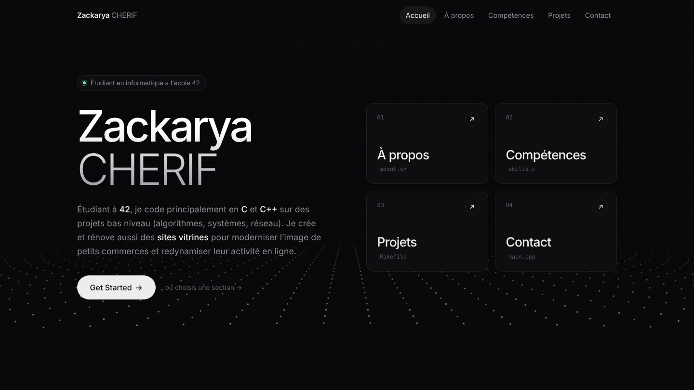
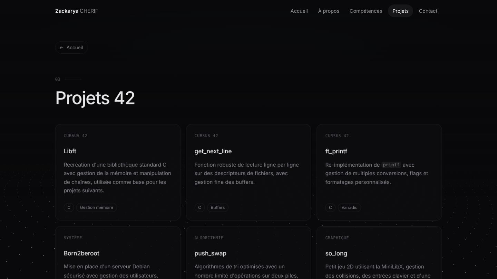

<div align="center">

# Portfolio — Zackarya Cherif

Mon portfolio personnel : parcours à l'école 42, compétences et projets du cursus.

[](https://zzzeelloo.github.io/)




</div>

---

## ✨ Fonctionnalités

- **Fond animé en perspective** : une houle de particules dessinée en Canvas 2D, avec un effet de parallaxe qui suit la souris.
- **Navigation par vues** : chaque section s'affiche comme un écran à part, avec routage par ancre (`#about`, `#projects`…) et prise en charge du bouton retour du navigateur.
- **Micro-interactions** : curseur personnalisé avec traînée, boutons magnétiques et apparition progressive des éléments.
- **Formulaire de contact** fonctionnel, branché sur [Formspree](https://formspree.io/).
- **Responsive** sur ordinateur, tablette et mobile, avec menu de navigation adapté.
- **Accessibilité** : les animations sont réduites quand le système demande `prefers-reduced-motion`.

## 🧱 Stack

Site 100 % statique, sans framework ni étape de build : HTML, CSS et JavaScript vanilla, hébergé sur GitHub Pages.

## 📁 Structure

```
.
├── index.html          # Structure de la page et contenu des sections
├── style.css           # Thème, mise en page responsive, animations
├── main.js             # Navigation, curseur, interactions, formulaire
├── particle-field.js   # Fond de particules animé (Canvas 2D)
└── assets/             # Captures d'écran du README
```

## 🚀 Lancer en local

```bash
git clone https://github.com/zzzeelloo/zzzeelloo.github.io.git
cd zzzeelloo.github.io
python3 -m http.server 8000
```

Puis ouvrir <http://localhost:8000>.

## 🖼️ Aperçu

<div align="center">

</div>

---

<div align="center">

**Zackarya Cherif** · [Portfolio](https://zzzeelloo.github.io/) · [Projets du cursus 42](https://github.com/zzzeelloo/42-Common-Core-projects)

</div>
